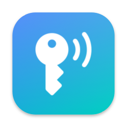
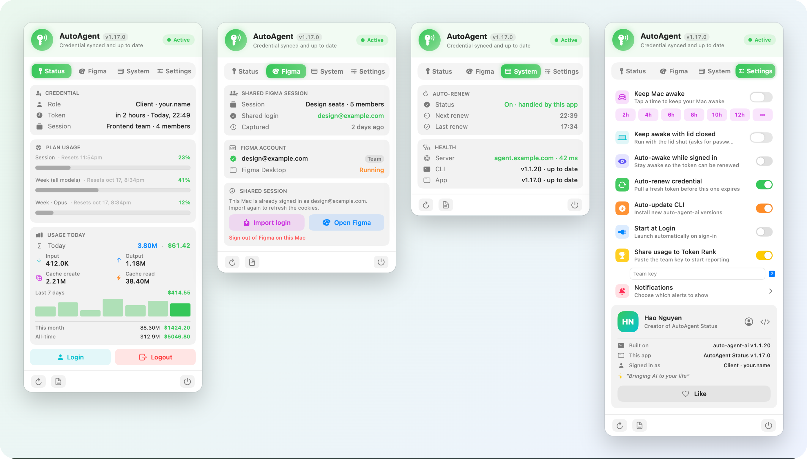
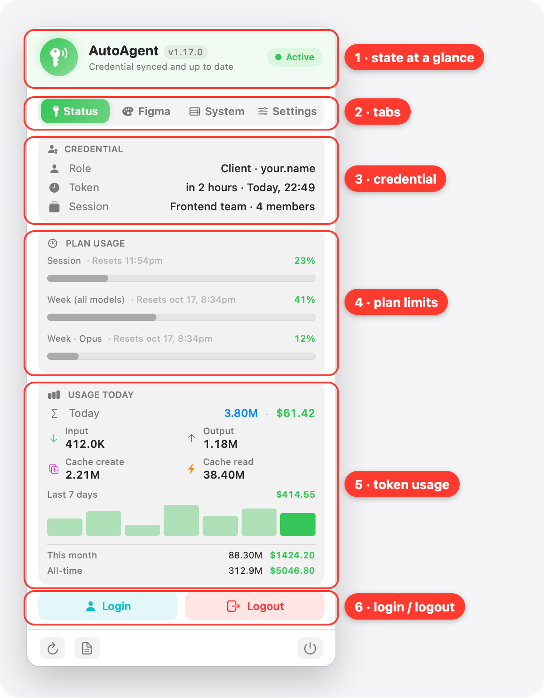
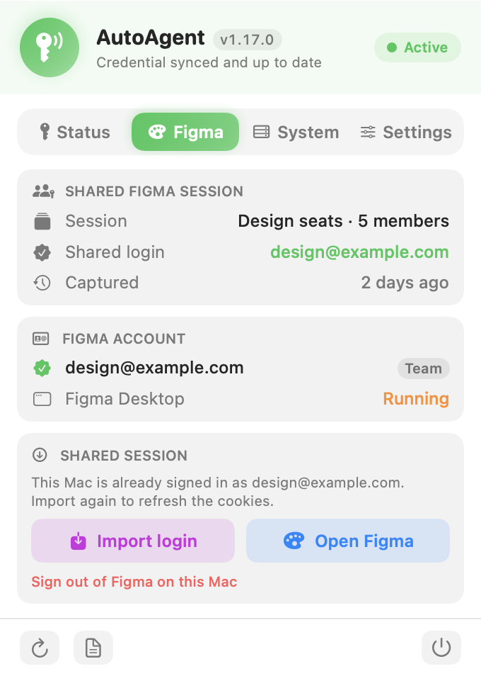
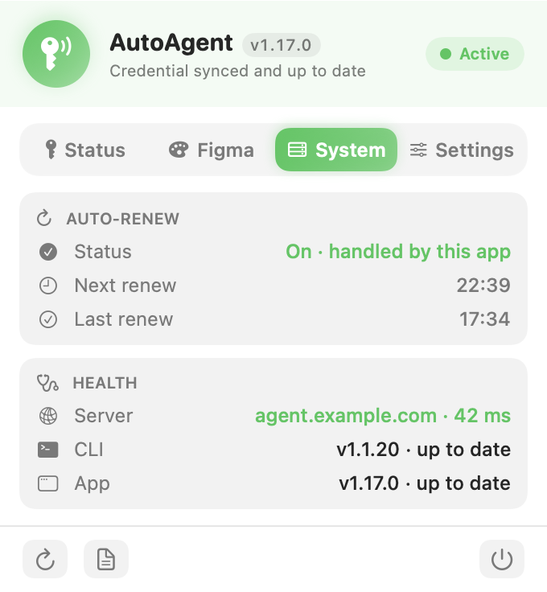
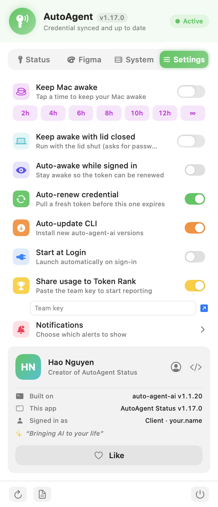
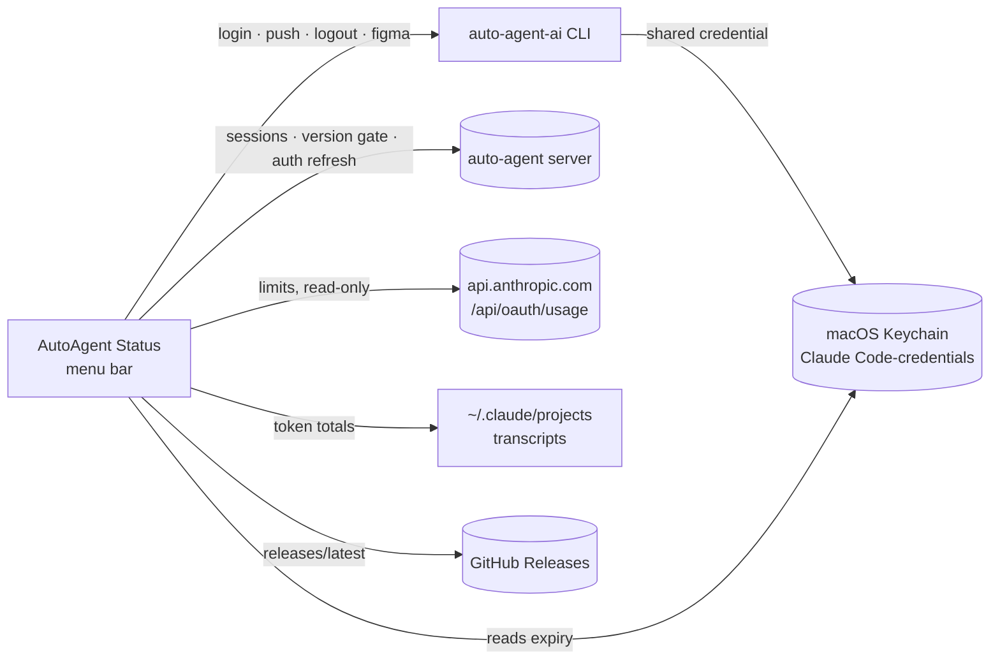

<div align="center">



# AutoAgent Status

**Your shared Claude Code credential, at a glance in the menu bar.**

A native macOS menu bar app for the `auto-agent-ai` CLI. It shows whether this Mac's credential is live, renews it before it expires,
tracks plan limits and token usage, and handles the shared Figma login, without ever opening a terminal.

<p>
  <a href="../../releases/latest"></a>
  
  
  
  
</p>

<a href="#features">Features</a> ·
<a href="#getting-started">Getting started</a> ·
<a href="#guide">Guide</a> ·
<a href="#how-it-works">How it works</a> ·
<a href="#for-the-maintainer">For the maintainer</a>

<br /><br />

<picture>
  <source media="(prefers-color-scheme: dark)" srcset="docs/hero-dark.png" />
  
</picture>

<sub>Screenshots use made-up data, rendered by <code>./snapshot.sh</code>.</sub>

</div>

---

## Features

### 🔑 Status in the menu bar
An icon plus the token countdown and your session limit, e.g. `2h 15m · 23%`, and a ☕ while the Mac is kept awake. It turns into a warning when something needs you.

### 📋 One panel, four tabs
| | |
|---|---|
| **Status** | Credential (role, token expiry, the AI session you pull from and who else is on it), plan limits, today's token usage with a 7-day chart and month / all-time totals, Login / Logout, **Push credential** for the owner. |
| **Figma** | Mirrors `auto-agent-ai figma`: the shared Figma session you're assigned to, the accounts signed in on this Mac, one-tap **Import login** (Figma Desktop is quit and reopened for you). Owners also get Share / Revoke / Switch token. |
| **System** | Auto-renew state with next / last renew, server health and latency, CLI and app versions. |
| **Settings** | Keep Mac awake (timed, or with the lid closed), auto-renew, auto-update the CLI, start at login, Token Rank, notifications. |

### 🔄 Auto-renew
Pulls a fresh credential about 10 minutes before the token expires, with your last role. It also keeps the CLI's short-lived server session refreshed, so nothing has to stay open in a terminal.

### 📊 Plan limits and token usage
The same session / weekly limits as Claude Code's `/usage` (read-only, costs no quota) and the same token totals as the CLI, read incrementally from `~/.claude/projects` so it stays fast on gigabytes of transcripts.

### 🔐 Microsoft sign-in
Opens your browser for OAuth and shows the sign-in link (Open / Copy) in case the browser doesn't pop up.

### 🔔 Notifications
Credential renewed, credential wiped, token expired, sign-in required, Figma session imported, back to normal. Each kind can be turned off.

### 🏆 Token Rank
Opt-in: share your token totals with the team leaderboard and see where you place.

### ⬆️ Updates itself
The app updates from this repo's Releases ("Update App"), and updates the CLI when a new version ships. The CLI check uses the server's own version gate (`/app-versions/check`), so you see the release notes and get warned about a mandatory update *before* a command hits the "update required" block.

---

## Getting started

### Requirements
- **macOS 13+**, Apple Silicon or Intel (the binary is universal)
- **[Node.js](https://nodejs.org) ≥ 18** for the CLI; the **Figma tab** needs Node ≥ 22.5 (the CLI uses its built-in SQLite for cookies)
- **Figma Desktop** in `/Applications`, only for the Figma tab
- The **`auto-agent-ai` CLI**:
  ```bash
  npm install -g @saigontechnology/auto-agent
  ```
  It is a **saigontechnology org package**: you need org access and a GitHub token with the `read:packages` scope. (This app is public; only the CLI is org-gated.)

### Install

Open Terminal and run:

```bash
curl -fsSL https://raw.githubusercontent.com/haonguyenstech/autoagent-status/main/install.sh | bash
```

It downloads the latest release, removes the Gatekeeper quarantine flag and launches the app. Run it again any time to update.

<details>
<summary><b>Manual install</b></summary>

Download the latest `AutoAgent-Status-x.y.z.zip` from [Releases](../../releases), unzip, then run:

```bash
bash Install.command
```

> 📌 Do **not** double-click the `.app` straight from the zip: macOS Gatekeeper blocks it ("Apple could not verify…"). The installer (or the one-liner) removes the quarantine flag for you. If you already hit the warning: click *Done*, then System Settings → Privacy & Security → *Open Anyway*.

</details>

### Updating

Nothing to do. The app checks this repo's Releases every 6 hours (or right away with **↻ Refresh**) and shows an **Update App** button when a new version exists. Click it: the app replaces itself and restarts. Or re-run the install one-liner.

### Uninstall

Quit the app (power button in the panel footer), then delete `~/Applications/AutoAgent Status.app`. To also remove the credential sync:
`auto-agent-ai logout && npm uninstall -g @saigontechnology/auto-agent`.

---

## Guide

### 1. Sign in once

Click the key icon in the menu bar → **Status** → **Login**. Your browser opens the Microsoft sign-in; if it doesn't, use the link the panel shows (**Open** / **Copy**). When the badge turns **Active**, Claude Code on this Mac is using the shared credential.

> 📌 After that there is nothing to keep open. Auto-renew pulls the next credential before this one runs out.

### 2. Read the Status tab

<p align="center"></p>

| | |
|---|---|
| **1 · State at a glance** | **Active** = the credential in your Keychain is valid. **Attention** = expired, renewing. **Offline** = signed out. |
| **2 · Tabs** | Status, Figma, System, Settings. The panel never scrolls; each tab fits. |
| **3 · Credential** | Your role and username, when the token expires, and the AI session this Mac pulls from with its member count. |
| **4 · Plan limits** | The 5-hour session and weekly limits of the account, with reset times. The session % is also in the menu bar. |
| **5 · Token usage** | Today's billable tokens and estimated cost, the split by input / output / cache, the last 7 days, this month and all-time. |
| **6 · Login / Logout** | Logout stops auto-renew and removes the credential from your Keychain (it asks first). Owners also see **Push credential** here. |

### 3. Use the shared Figma login

<p align="center">
  <picture>
    <source media="(prefers-color-scheme: dark)" srcset="docs/snapshots/figma-dark.png" />
    
  </picture>
</p>

1. **Shared Figma session** shows the session you're assigned to and which account it signs you in as.
2. Click **Import login**. If Figma Desktop is running, the app quits it, imports the cookies and reopens it.
3. **Figma account** now shows that account as active on this Mac.

> 📌 **Import login** is offered only once the owner has actually uploaded a login, the same rule as the CLI. Not assigned to a session yet? The tab says so; ask the session owner to add you.

### 4. Check health on the System tab

<p align="center">
  <picture>
    <source media="(prefers-color-scheme: dark)" srcset="docs/snapshots/system-dark.png" />
    
  </picture>
</p>

**Auto-renew** shows when the next renew will run and when the last one did. **Health** pings the server (with latency) and compares the installed CLI and app with the latest versions; an **Update CLI** / **Update App** button appears when one is behind.

### 5. Tune it in Settings

<p align="center">
  <picture>
    <source media="(prefers-color-scheme: dark)" srcset="docs/snapshots/settings-dark.png" />
    
  </picture>
</p>

- **Keep Mac awake**: tap 2h … 12h or ∞. **Keep awake with lid closed** runs with the lid shut (asks for your password once; always undone when the app quits).
- **Auto-awake while signed in**: stay awake so the token can be renewed overnight.
- **Auto-renew credential** and **Auto-update CLI**: on by default.
- **Share usage to Token Rank**: paste the team key; the ↗ button opens the leaderboard.
- **Notifications**: choose which alerts to show.

---

## How it works



- **State** comes from the credential Claude Code actually reads: Keychain item `Claude Code-credentials`, unexpired = **Active**. No helper process has to be alive.
- **Actions** shell out to the CLI (`login --role owner|client`, `push`, `logout`, `figma …`), found on `PATH` or through your login shell (nvm / volta / asdf installs work).
- **Usage** is cached per transcript file in `~/Library/Caches/AutoAgentStatus/`, so only changed sessions are re-read.
- The repo is **public** and the app embeds **no secrets**: the shared credential lives in each user's Keychain, managed by the CLI.

---

## For the maintainer

Swift in a single file (`Sources/main.swift`), built with `swiftc`, no Xcode project.

```bash
./build.sh        # universal build → ~/Applications/AutoAgent Status.app
./snapshot.sh     # README screenshots → docs/snapshots/ (made-up data, light + dark)
```

`snapshot.sh` compiles the same views with `-D SNAPSHOT` and renders every tab offscreen from a demo store (`Snapshots/Snapshot.swift`). It runs under its own bundle id and never calls the CLI or the server, so no real account, session or key can end up in an image. The release build is unaffected.

**Release a new version:**

```bash
# 1. bump CFBundleShortVersionString (and CFBundleVersion) in Info.plist
# 2. make sure the right GitHub account is active:
gh auth switch --user haonguyenstech
# 3. build + publish the release:
./release.sh
```

`release.sh` builds the universal binary, packages `dist/AutoAgent-Status-<ver>.zip` and creates the GitHub Release. New users install with the public one-liner (`install.sh`); existing apps update themselves from Releases.

---

<div align="center"><sub>Made by <a href="https://github.com/haonguyenstech">Hao Nguyen</a> · Built on <code>auto-agent-ai</code></sub></div>
